# Super-Cortex (`super-cortex`)

High-performance, zero-inference cryptographic graph memory engine, 3D neural manifold visualizer, and Model Context Protocol (MCP) server for the Xibalba ecosystem. Its memory backend is the **SuperCortex engine** (`super_cortex.engine`, see [docs/ENGINE.md](docs/ENGINE.md)), which serves the same HTTP API as Supermemory Local, so either backend works behind `SUPERMEMORY_URL`.


> **Bring your own model.** Learning memories from raw notes needs an LLM. Super-Cortex lets the agent you already run do it: your session claims pending documents, extracts memories with its own model, and submits them, so extraction costs nothing extra. Every memory must quote its source verbatim or it is rejected. See [Bring your own model](#bring-your-own-model-session-extraction).

---

## Architecture Overview

```mermaid
flowchart TD
    subgraph ExternalSources["External Ingestion & Continuous Connectors"]
        A1["Web Clipper Bookmarklet (1-Click)"]
        A2["Directory Watcher ('super-cortex watch')"]
        A3["Direct CLI Ingest ('super-cortex ingest')"]
        A4["MCP Stdio Transports (Claude Code, Cursor, AGY)"]
    end

    subgraph ZeroInferenceEngine["Deterministic Extraction & Classification Engine (<10ms)"]
        B1["Epistemic Classifier (Rule, Fact, Decision, Inference, Belief, Goal)"]
        B2["SOP Triples Extractor ((Subject, Predicate, Object))"]
        B3["PARA Lexical Categorizer (Projects, Areas, Resources, Archives)"]
        B4["Bitemporal Validator (valid_from, valid_until, is_currently_valid)"]
    end

    subgraph StorageLedger["Hybrid Dual-Engine Storage"]
        C1["SuperCortex engine (SUPERMEMORY_URL)<br>Hybrid FTS5 + vector search, grounded learned memories, per-namespace retention"]
        C2["Cryptographic Provenance Store (~/.super-cortex/provenance.db)<br>Append-Only SHA-256 Hash Chain & Merkle Roots"]
    end

    subgraph StudioViewer["Super-Cortex Studio (http://127.0.0.1:4174)"]
        D1["3D Neural Graph Manifold (Three.js WebGL)"]
        D2["Session Timeline & Turn Replay"]
        D3["Spectral Math Studio (Laplacian Spectrum λ0..λ4)"]
        D4["Dialogue Graph & Reasoning Trajectory"]
        D5["Memory Fabric Catalog & Bitemporal Filters"]
        D6["Connectors & Ingestion Hub"]
        D7["Deterministic Extraction Studio"]
        D8["Agent Scopes & MCP Configuration"]
        D9["AIS Cryptographic Audit Ledger"]
    end

    ExternalSources --> ZeroInferenceEngine
    ZeroInferenceEngine --> StorageLedger
    StorageLedger --> StudioViewer
```



---

## Core Invariants

1. **Zero-Inference Latency & Determinism**:
   - Extraction of epistemic classes, PARA categories, and Subject-Object-Predicate (SOP) relational propositions is accomplished via deterministic regex and grammars—zero external LLM API cost, zero network latency, and zero model hallucinations.
2. **Cryptographic Provenance Hash-Chains**:
   - Append-only tamper-evident event history where every state transition (`remember`, `contradict`, `supersede`, `forget`, `link_entities`) is chained via SHA-256 (`prior_hash -> event_hash`).
3. **Session-Level Merkle Roots & Turn Proofs**:
   - Multi-turn agent interaction turns are hashed and committed into domain-separated Merkle trees (`memory_session_merkle_root`), producing verifiable cryptographic inclusion proofs (`.cortex.proof`).
4. **Bitemporal Knowledge Tracking**:
   - Distinct separation between event assertion time (`created_at`) and domain truth validity (`valid_from`, `valid_until`, `is_currently_valid`, `superseded_by`).
5. **Graph Laplacian Spectral Math**:
   - Continuous computation of the normalized graph Laplacian spectrum ($\lambda_0..\lambda_4$), algebraic connectivity ($\lambda_2$), and Fiedler vector graph partitioning.
6. **Agent Scopes & ABAC Enclaves**:
   - Multi-agent isolation preventing cross-agent memory contamination between private agent enclaves (`agent:claude`, `agent:xibalba`, `agent:hermes`) and the shared knowledge fabric.

---

## Quickstart

### Prerequisites
- Python 3.12+ with `uv`
- A memory backend at `SUPERMEMORY_URL` with its key in `SUPERMEMORY_API_KEY`: the SuperCortex engine ([docs/ENGINE.md](docs/ENGINE.md)), or Supermemory Local (default `http://127.0.0.1:6767`)

### Diagnostic Doctor
Verify daemon connectivity, API key authorization, and database chain integrity:
```bash
uv run super-cortex doctor
```

### Prompt-Ready Context Injection (<5ms)
Output zero-inference prompt markdown for direct injection into system prompts:
```bash
# Print markdown context block for shared scope
uv run super-cortex context --scope shared

# Pipe directly into agent or llm CLI
uv run super-cortex context --scope agent:claude | claude -p "Answer based on context"

# Output structured JSON
uv run super-cortex context --scope shared --format json
```

### Direct Ingestion (CLI)
Ingest web pages, local documentation, or markdown files into Supermemory Local and the provenance ledger:
```bash
# Ingest local file
uv run super-cortex ingest ~/Documents/Notes/spec.md --scope shared

# Ingest and scrape web documentation
uv run super-cortex ingest https://docs.anthropic.com/en/docs/overview --scope shared
```

### Directory Auto-Watcher Daemon
Continuously monitor a directory for new or modified markdown, text, or JSON files and index them into memory automatically:
```bash
uv run super-cortex watch ~/Documents/Notes/ --scope shared --interval 2.0
```

### Launching the Studio Web Interface
Start the full 9-view 3D Neural Graph Manifold Studio:
```bash
uv run super-cortex viewer --port 4174
```
Open [http://127.0.0.1:4174](http://127.0.0.1:4174) in your browser.

---

## Bring Your Own Model: Session Extraction

Raw documents become learned memories through extraction, which needs an LLM. Instead of the engine calling a hosted model, the agent session you are already running can do the work on its own inference, at no extra cost.

1. **Claim**: the engine leases up to 10 pending documents (15 minutes) and returns the extractor instructions, the prompt (documents `D1..Dn`, related memories `M1..Mn`) and the JSON schema.
2. **Extract**: your model writes short memories, each with a quote copied from its document, a `kind` and a `certainty`.
3. **Submit**: the engine keeps a memory only if its quote is found in the document. It rejects anything that looks like a secret, merges near-duplicates, supersedes stale facts, and applies the certainty floors. Each memory records `generator: session:<model>`.

From any MCP agent (Claude Code, Codex, Antigravity, Cursor, Hermes):

```text
memory_extraction_claim(namespace?, limit?)    -> claimId, instructions, prompt, responseSchema
memory_extraction_submit(claim_id, documents, model?)
memory_extraction_release(claim_id)            # give it back unfinished
```

From the command line, with any agent CLI that reads a prompt on stdin:

```bash
uv run super-cortex extract run --with "claude -p"          # loop until the queue is empty
uv run super-cortex extract run --with "codex exec" -n shared --max-claims 5

# or by hand
uv run super-cortex extract claim --prompt > prompt.txt     # claimId is printed to stderr
uv run super-cortex extract submit <claimId> answer.json --model my-model
```

Namespaces whose policy is `dreaming: off` are never handed to any model. Session extraction needs the SuperCortex engine backend ([docs/ENGINE.md](docs/ENGINE.md#bring-your-own-model-session-extraction)); the background Gemini worker can run alongside it, and the two never extract the same documents.

---

## 1-Click Browser Web Clipper

Super-Cortex provides a zero-install browser bookmarklet for 1-click ingestion of web articles, documentation, and GitHub repos.

1. Open [http://127.0.0.1:4174/clipper.html](http://127.0.0.1:4174/clipper.html) in your browser.
2. Drag the cyan **`⚡ Clip to Super-Cortex`** button to your browser's Bookmarks Bar.
3. On any webpage, click the bookmarklet to scrape, extract epistemic rules, and anchor it into Supermemory Local in <100ms.

---

## Data Science, Graph ML & Reasoning Trajectory Hub

Super-Cortex provides native, zero-dependency data science export capabilities, graph theory quantitative analytics, and AI reasoning trajectory dataset hubs. See [docs/DATA_SCIENCE.md](docs/DATA_SCIENCE.md) for full documentation.

### 1. Python SDK Interoperability
```python
from super_cortex.memory import SuperCortex

cortex = SuperCortex()

# Direct conversion into standard analytical objects
G = cortex.to_networkx(scope="shared")              # NetworkX DiGraph
nodes_df, edges_df = cortex.to_polars(scope="shared") # Polars DataFrames
pyg_data = cortex.to_pyg(scope="shared")             # PyTorch Geometric Data tensor

# Quantitative graph analytics
scorecard = cortex.get_graph_analytics(scope="shared") # Modularity Q, clustering, centralities
communities = cortex.get_communities(scope="shared")   # Louvain community clusters
spectral = cortex.get_spectral_properties(scope="shared") # Laplacian eigenvalues, Fiedler vector

# AI Fine-tuning datasets
sft_dataset = cortex.export_sft_dataset(scope="shared")  # ChatML with thinking traces
dpo_pairs = cortex.export_dpo_dataset(scope="shared")    # Chosen/Rejected preference pairs
grpo_samples = cortex.export_grpo_dataset(scope="shared") # RLVR verification samples
```

### 2. Direct REST Export Endpoints
- **NetworkX & Gephi:** `GET /api/export/networkx?format=json|graphml`
- **DataFrames:** `GET /api/export/dataframe?table=nodes|edges&format=csv|json`
- **PyTorch Geometric:** `GET /api/export/pyg`
- **Dynamic Jupyter Notebooks:** `GET /api/export/notebook?template=spectral|gnn|trajectories`
- **AI Fine-Tuning Datasets:** `GET /api/export/trajectories?format=sft|dpo|grpo&as_jsonl=true`
- **Quantitative Analytics:** `GET /api/analytics/summary`, `/api/analytics/communities`, `/api/analytics/centrality`, `/api/analytics/spectral`

### 3. Pre-Packaged Runnable Notebooks
- [`notebooks/01_spectral_graph_analysis.ipynb`](notebooks/01_spectral_graph_analysis.ipynb): Graph Laplacian spectra, algebraic connectivity ($\lambda_2$), and Louvain community visualization.
- [`notebooks/02_gnn_node_classification.ipynb`](notebooks/02_gnn_node_classification.ipynb): End-to-end PyTorch Geometric GCN training on live graph tensors.
- [`notebooks/03_reasoning_trajectory_analytics.ipynb`](notebooks/03_reasoning_trajectory_analytics.ipynb): Reward margin analysis and token distributions for fine-tuning.

---

## Studio Views (9 Interactive Workbenches)

| View | Access Key | Purpose |
|---|---|---|
| **3D Neural Graph Manifold** | `[1]` | Real-time Three.js WebGL lattice with 3D/2D projection, raycasting, camera flythrough, and SOP relational edges. |
| **Session Timeline** | `[2]` | Multi-turn dialogue playback with turn-by-turn prompt/response inspection and Merkle inclusion proof export. |
| **Spectral Math Studio** | `[3]` | Laplacian spectrum calculation ($\lambda_0..\lambda_4$), algebraic connectivity ($\lambda_2$), and Dirichlet energy analysis. |
| **Dialogue Graph** | `[4]` | Cumulative dialogue reasoning trajectories, synaptic curved connectors, and tool executions. |
| **Memory Fabric Catalog** | `[5]` | Filterable catalog with bitemporal validity tags, SOP Triples badges, and 3D focus navigation. |
| **Connectors & Ingestion Hub** | `[6]` | Continuous connectors hub, live URL scraper, local file ingestor, and 1-click Web Clipper launcher. |
| **Extraction Studio** | `[7]` | Live zero-inference workbench with presets (Rule, Decision, Milestone, Resource) and memory backfill. |
| **Agent Scopes & MCP** | `[8]` | Multi-agent ABAC scope manager, agent registration table, and stdio config generators for Claude Code, Cursor, and AGY. |
| **AIS Cryptographic Audit** | `[9]` | Verifiable 32-block SHA-256 event ledger, AIS invariant monitors ($S_g, S_c, S_l=1.000$), and contradiction scanner. |

---

## MCP Server Configuration

Super-Cortex implements the Model Context Protocol (MCP) over both `stdio` and HTTP/SSE transports.

### Claude Code (`~/.claude.json` or `claude mcp add`)
```json
{
  "mcpServers": {
    "super-cortex": {
      "command": "uv",
      "args": ["run", "--directory", "/home/xibalba/Projects/super-cortex", "super-cortex", "run", "--transport", "stdio"]
    }
  }
}
```

### Cursor (`~/.cursor/mcp.json`)
```json
{
  "mcpServers": {
    "super-cortex": {
      "command": "uv",
      "args": ["run", "--directory", "/home/xibalba/Projects/super-cortex", "super-cortex", "run", "--transport", "stdio"]
    }
  }
}
```

### Antigravity (`~/.gemini/antigravity-cli/mcp_config.json`)
```json
{
  "mcpServers": {
    "super_cortex": {
      "command": "uv",
      "args": ["run", "--directory", "/home/xibalba/Projects/super-cortex", "super-cortex", "run", "--transport", "stdio"]
    }
  }
}
```

---

## Background Daemon & Systemd Units

To keep the memory backend and Super-Cortex Studio running on system startup (unit names are examples; see [docs/ENGINE.md](docs/ENGINE.md) for moving clients from Supermemory to the engine):

```bash
# Enable and start the SuperCortex engine
systemctl --user enable --now super-cortex-engine.service

# Enable and start Super-Cortex Studio interface (port 4174)
systemctl --user enable super-cortex-studio.service
systemctl --user start super-cortex-studio.service

# Check status
systemctl --user status super-cortex-studio.service
```

---

## Testing & Quality Assurance

Run the test suite:
```bash
uv run pytest -v
```
Tests cover store operations, cryptographic chain integrity, MCP server endpoints and the engine (retention policy, dreaming, certainty floors, profile dating). Engine-only tests need the `engine-local` extra: `uv run --extra engine-local pytest`.

---

## Organization & Executive Inquiries

**Xibalba Solutions LLC**
- **Corporate Portal:** [https://xibalbasolutions.com](https://xibalbasolutions.com)
- **Executive Contact:** [jacob@xibalbasolutions.com](mailto:jacob@xibalbasolutions.com)
- **Direct Telephone:** `+1 (262) 864-1589`
- **Headquarters:** Wisconsin, United States
- **Commercial Verticals:**
  - **Integrity Protocol:** On-chain agent control layer, verifiable DIDs, and deterministic AIS feedback.
  - **Super-Cortex:** Local-first 3D graph memory, Merkle-attested provenance, and agent trajectory planning.
  - **Xibalba Shield:** Deterministic response governance, boundary gating, and host containment.

