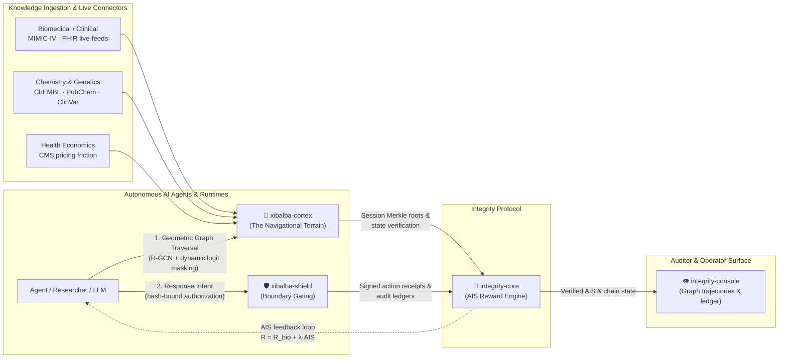

# Xibalba Cortex: Navigational AI Knowledge Graph Manifold

> **The Navigational Engine for Verifiable Autonomy**

Generative AI is trapped in an unconstrained latent space where hallucinating a fake pathway takes the exact same computational energy as reciting a real one. The industry attempts to fix this with software "guardrails," but from a first-principles physics standpoint, guardrails are merely artificial thermodynamic friction: in any Reinforcement Learning (RL) environment, an autonomous agent will mathematically optimize for its goal by finding the lowest-energy path around them.

**Xibalba Cortex discards unconstrained generation in favor of geometric graph traversal.**

Cortex is the **Navigational Knowledge Graph Manifold** ($G=(V, E, \Phi)$) and active inference engine designed for autonomous agents and biomedical researchers. Instead of predicting the next token, agents operating inside Cortex physically "walk" the topological edges of verified data. Logic is no longer simulated through statistical correlation; it is a literal, continuous geometric trajectory with discrete action spaces ($\mathcal{A}$) and a mathematically closed-loop Agent Integrity Score (AIS) reward function. If an edge does not exist in the verified graph, the step cannot be taken—rendering hallucination structurally impossible.

**The path itself is the proof.**

---

## Navigational AI & Closed-Loop AIS Reward Function

### 1. The Knowledge Graph Manifold ($G = (V, E, \Phi)$)
Autonomous agents in Cortex do not emit unbounded hallucinations. Every agent state $s_t \in \mathcal{S}$
is anchored to a verified node or subgraph within the manifold $G$. Actions $a_t \in \mathcal{A}$ are
discrete directional traversals across typed, cryptographically verified edges $e = (u, v, r, w)$.

### 2. The AIS Closed-Loop Reward Function
Cortex implements reinforcement learning with verifiable integrity:
$$R_{\text{total}}(s_t, a_t) = R_{\text{task}}(s_t, a_t) + \lambda \cdot \text{AIS}(s_t, a_t)$$

The **Agent Integrity Score (AIS)** is engineered as a zero-tolerance multiplicative invariant:
$$\text{AIS} = 1000 \cdot \left(S_{\text{grounding}}^{w_g} \cdot S_{\text{compliance}}^{w_c} \cdot S_{\text{sacrifice}}^{w_s} \cdot S_{\text{entropy}}^{w_e}\right)^{\frac{1}{\sum w}}$$

- **Grounding Invariant ($S_{\text{grounding}}$):** Ratio of proposed entities and claims rooted in verified graph triples or Merkle proofs. If an ungrounded entity is proposed, $S_{\text{grounding}} = 0 \implies \text{AIS} \equiv 0$, rendering hallucination mathematically impossible.
- **Compliance Invariant ($S_{\text{compliance}}$):** Strict verification against BCC intent policies, PHI isolation boundaries, and deterministic security rules. Any policy breach immediately drops $S_{\text{compliance}} = 0$.
- **Sunk Energy Sacrifice ($S_{\text{sacrifice}}$):** Attested compute or cryptographic proof (e.g. WASM policy evaluation, Merkle leaf generation) proving honest commitment before execution.
- **Topological Entropy ($S_{\text{entropy}}$):** Spectral entropy $H(L) = -\sum \lambda_i \ln \lambda_i$ computed over the normalized graph Laplacian, preventing agent entrapment in degenerate loops or cyclic action spaces.

### 3. Asymmetric Slashing & Quarantine
Unwanted agent behaviors are made economically and computationally catastrophic. Any zero-score breach triggers:
- Immediate 50% bonded stake burn on Ethereum L2 Base.
- Kernel-level quarantine via eBPF containment.
- Dual-witness proof emission written immutably to the transaction ledger.

---

## Core Capabilities & Features

### 1. Ingestion Connectors for Researchers & Agents
- **CSV/TSV Triples Connector:** Ingest high-volume Subject-Predicate-Object triples with custom confidence weights and ontological mapping (`src/xibalba_cortex/connectors/triples.py`).
- **PubMed & Biomedical Literature Connector:** Automated NLP entity extraction from scientific papers, abstracts, PMIDs, and DOIs (`src/xibalba_cortex/connectors/biomedical.py`).
- **HL7 FHIR Clinical EHR Connector:** Ingestion of FHIR Patient, Condition, Observation, and MedicationRequest resources with automated de-identification and zero-leakage PHI isolation (`src/xibalba_cortex/connectors/fhir.py`).

### 2. Active Inference & Link Prediction
- **Geometric TransE Link Prediction:** Evaluates continuous translation distance $f_r(h, t) = \|h + r - t\|_{1/2}$ combined with topological Jaccard coefficients to score unmapped candidate therapeutic links and drug repurposing opportunities (`src/xibalba_cortex/store.py`).
- **Interpretable Multi-Hop Traversal:** Resolves all shortest biological and mechanistic pathways connecting candidate drugs, target pathways, and clinical disease endpoints.
- **Inference Subagent Synthesis:** An automated background subagent distills raw session exchanges and agent trajectory memories into structured triples and verifies AIS invariants (`store.summarize_session_with_inference_subagent`).

### 3. Formal Graph Mathematics Studio
The Console includes a full analytical mathematics engine (`/api/graph/math` and `GraphMathStudio.tsx`):
- **Adjacency Matrix ($A$):** Interactive $N \times N$ matrix visualization with sparsity metrics and spectral radii.
- **Cosine Similarity Matrix ($S_{\cos}$):** High-dimensional topological and embedding cosine similarity heatmaps.
- **Spectral Graph Theory & Graph Laplacian ($L = D - A$):** Eigenvalue spectra, algebraic connectivity (Fiedler value $\lambda_2$), and connected component clustering.
- **Centrality Leaderboards:** Degree Centrality, Betweenness Centrality, and Eigenvector Centrality identifying influential hubs and structural bottlenecks.

### 4. 3D Lattice Grid Snapping, Zen Flight Mode & Camera Presets
- **3D Lattice Snapping:** Discrete spatial snapping of graph nodes to coordinate cells, ensuring structural clarity and consistent topology.
- **Zen Flight Mode:** One-key toggle (`Z`) that collapses all chrome, rails, and inspectors for pure graph immersion with 3D flight controls:
  - **Full Flight Controls:** `W` / `S` for Pitch, `A` / `D` for Yaw, `Q` / `E` for Roll, and `Space` / `Shift` for vertical elevation thrust.
  - **D-Pad HUD & Velocity Control:** On-screen touch/mouse flight HUD with real-time yaw/pitch/roll dials, step-dampened motion, and keyboard shortcuts cheatsheet (`?`).
  - **Orthographic & Isometric Presets:** Instant camera reorientation via keyboard hotkeys:
    - `1` / **ISO:** Isometric angled perspective
    - `2` / **TOP:** Planar overhead bird's-eye projection
    - `3` / **FRONT:** Coronal front elevation view
    - `4` / **SIDE:** Sagittal lateral profile view

### 5. Inner Sanctum Node Room: Novel Spatial & Mathematical Forms
Double-clicking or focusing any node transitions from orbital graph space into an octagonal spatial chamber—representing node properties and mathematical primitives in novel spatial forms:
- **Starburst Quiver Vector Field:** High-dimensional node vectors and embeddings are rendered as a 3D spherical quiver of radiating coordinate arrows. Hovering over individual arrows isolates coordinate values, magnitude, and vector divergence.
- **Degree Centrality Obelisk:** A 4-tier monolithic pillar visualizing connectivity, in/out degrees, and network centrality with glowing tier rings and gradient status.
- **AIS Gyroscope:** A dual-gimbal floating gyroscope visualizing the four Agent Integrity Score (AIS) invariants—Grounding, Compliance, Sunk Sacrifice, and Topological Entropy—with dynamic angular precession reflecting composite score integrity.
- **Dirichlet Energy Ripple Pool:** A concentric wave pool on the chamber floor measuring graph smoothness and topological harmonic frequency.
- **Subject-Predicate-Object Portals & ⚡ Warp Traversal:** Hexagonal holographic gateways representing typed outbound and inbound relations (`INHIBITS`, `REGULATES`, `HAS_OBSERVATION`, `TREATS`). Clicking **⚡ Warp** instantly warps the camera through the portal directly into the target entity's Inner Sanctum chamber.

### 6. Healthcare Researcher Latent Space Agent Demo
Available out-of-the-box to all users across self-hosted and managed editions via the Console workspace selector:
- **Canonical DID:** `did:integrity:healthcare-researcher-latent-space-01`
- **138 Verified Clinical Triples:** Real-world Precision Oncology dataset modeling:
  - Molecular targets & mutations (`EGFR`, `EGFR T790M`, `EGFR Exon 19 Deletion`, `KRAS G12C`)
  - Targeted therapeutics & resistances (`Osimertinib`, `Gefitinib`, `Sotorasib`)
  - Diagnostic modalities (`Next-Generation Sequencing`, `ctDNA Liquid Biopsy`)
  - Adverse toxicities & management (`Grade 3 Interstitial Lung Disease`, `High-Dose Corticosteroids`)
  - PARA Architecture: Projects (`NSCLC Resistance Mapping`), Areas (`Thoracic Oncology Research`), Resources (`NCCN Guidelines v4.2024`), Archives (`FLAURA Clinical Trial Data`)
  - Standard Operating Procedures (SOPs): `SOP-ONC-042: Precision Oncology Molecular Tumor Board Review`
  - Agent MDP Latent States: Discrete Markov Decision Process state spaces and valid action transitions across clinical diagnostic horizons.

### 7. Maximized Knowledge Graph Canvas & Dark Glass Micro-Icons
The console UI is engineered for maximum screen real estate and zero visual interference:
- **Slim 34px Header:** Compact titlebar and controls maximizes vertical WebGL viewport area.
- **Collapsible Margin Rails:** The right ChainRail collapses flush into a sleek margin handle, while Projection controls nest compactly within the left navigation rail.
- **Dark Glass Micro-Icons:** High-contrast micro-icon buttons (`rgba(11, 15, 25, 0.75)` with `backdrop-filter: blur(12px)`) eliminate canvas washout and protect the visibility of 3D node geometry.

---

## The Four-Repository Ecosystem Topology

The Integrity Ecosystem aligns autonomous machine behavior with cryptographic and thermodynamic reality across four specialized repositories:

| Repository | Role | Paradigm & Function |
|---|---|---|
| **`xibalba-cortex`** | **🧠 The Navigational Engine** | Neuro-symbolic knowledge graph and active inference engine. Replaces probabilistic text generation with geometric graph traversal (R-GCN + TKGE), dynamic logit masking, temporal event reification, and domain connectors (Biomedical/MIMIC-IV, FHIR, ChEMBL, CMS cost friction). |
| **`integrity-core`** | **🦴 The Physics Engine of the Machine Economy** | Implements the Autonomous Integrity Score (AIS) as the deterministic reward function ($R_{\text{total}} = R_{\text{task}} + \lambda \cdot \text{AIS}$). Governs on-chain DIDs, Behavioral Commitment Chains (BCC), Merkle state anchors, and cryptographic state verification. |
| **`xibalba-shield`** | **🛡️ Cryptographic Topology & Response Governance** | Enforces topological boundary gating, zero-probability unauthorized state spaces, and vendor-neutral response governance across enterprise EDRs (CrowdStrike, Defender) and AI agents (MCP, SOAR). *"The EDR detects and acts; Shield proves who authorized it."* Produces tamper-evident audit ledgers and HIPAA assurance packets. |
| **`integrity-console`** | **👁️ The Universal Verifiable Operator Window** | Unified presentation and account layer. Visualizes agent graph navigation trajectories, multi-agent DID credentials, AIS score distributions, real-time response approval queues, and cryptographic Merkle verification. |



---

## Neuro-Symbolic Architecture & Mathematical Foundations

### 1. The Terrain: Knowledge Graph Embeddings & Ontology Alignment
Cortex ingests unstructured literature and structured records, mapping them into strict `(Subject, Predicate, Object)` semantic triples bound to standardized ontologies (UMLS, MeSH, Gene Ontology). Entity and relation vectors are projected into a continuous geometric vector space using TransE / RotatE models where the scoring function minimizes spatial translation distance:
$$E(h, r, t) = \|h + r - t\|_p$$
By minimizing this energy state, the system scores unmapped edges to predict mathematically viable therapeutic hypotheses and biological mechanisms.

### 2. The Visual Cortex: Relational Graph Convolutional Networks (R-GCN)
Before an agent takes a step, an R-GCN aggregates relational context from the 1-hop and 2-hop biological neighborhood:
$$h_i^{(l+1)} = \sigma \left( \sum_{r \in \mathcal{R}} \sum_{j \in \mathcal{N}_i^r} \frac{1}{c_{i,r}} W_r^{(l)} h_j^{(l)} + W_0^{(l)} h_i^{(l)} \right)$$
To prevent the agent from selecting non-existent or unverified edges, Cortex applies **Dynamic Logit Masking** prior to Softmax:
$$z_{\text{masked}} = z \circ M + (-\infty \times (1 - M))$$
Where $M$ is a binary adjacency mask of verified outgoing edges. The agent is mathematically constrained to verified physical and biological reality.

### 3. Temporal Event Reification & TKGE
Fluctuating time-series data (lab values, medication dosages, vitals) cannot be represented as static edges without causing multi-graph collisions. Cortex reifies clinical events into discrete nodes:
$$\text{Patient} \xrightarrow{\text{HAS\_OBSERVATION}} \text{Event\_Node} \xrightarrow{\text{OF\_TYPE}} \text{Measurement}$$
$$\text{Event\_Node} \xrightarrow{\text{HAS\_VALUE}} 14.2, \quad \text{Event\_Node} \xrightarrow{\text{OCCURRED\_AT}} T_1$$
This preserves a strict Directed Acyclic Graph (DAG) for Temporal Knowledge Graph Embeddings (TTransE):
$$E(h, r, t, \tau) = \|h + r + \tau - t\|_p$$

### 4. Economic & Multi-Domain Connectors
- **CMS Health Economics:** Introduces a cost-penalty scalar $\lambda C(e)$ into the energy function ($E_{\text{total}} = E_{\text{path}} + \lambda C(e)$), balancing biological affinity against therapeutic cost.
- **FHIR REST API Connector:** Direct JSON bundle mapper streaming live hospital observations (`LOINC`), prescriptions (`RxNorm`), and conditions (`ICD-10`) into reified event nodes.
- **Biomolecular Grounding:** Direct mapping from ChEMBL and PubChem for molecular properties and target binding affinities.
- **Exposome:** Environmental vectors (EPA air quality) bridging patient geography to clinical disease phenotypes.

### 5. Biomedical Discovery & Active Inference Pipeline

```
[ Biomedical PDFs / PubMed / EHRs ]
               │
               ▼
   [ LLM / NLP Triple Extraction ]  ──(Subject, Predicate, Object)
               │
               ▼
    [ Vectorized Knowledge Graph ]  ──(TransE / KGE Continuous Space)
               │
               ▼
[ Multi-Hop Traversal & Hypothesis Scoring ]
```

#### A. Ingestion & Automated Triple Extraction
Unstructured text from PubMed Central articles, clinical trial registries, and multi-omics databases is parsed into strict semantic triples `(head entity, relation, tail entity)`:
- **Entity Taxonomy:** Genes, proteins, metabolites, small molecule drugs, phenotypes, adverse events, and disease classifications.
- **Ontology Normalization:** Normalizing entities against standardized biomedical taxonomies (UMLS, MeSH, Gene Ontology, RxNorm, LOINC) prevents semantic fragmentation (e.g., ensuring *"non-small cell lung carcinoma"* and *"NSCLC"* resolve to the identical node).

#### B. Geometric Link Prediction for Drug Repurposing
Standard relational queries fail when researchers ask open-ended exploratory questions like: *"What unstudied kinase inhibitors might affect neuroinflammation pathways?"*
- **Scoring Hidden Edges:** Cortex evaluates missing or unmapped edges. If drug $A$ inhibits target protein $B$, and protein $B$ is structurally implicated in pathway $C$ (associated with disease $D$), the vector translation distance $f_r(h, t) = \|h + r - t\|$ surfaces a mathematically ranked therapeutic hypothesis for experimental validation.
- **Traceable Mechanistic Paths:** Because hypotheses are derived from explicit graph walks, predictions are fully interpretable:
  $$\text{Drug } A \xrightarrow{\text{inhibits}} \text{Target } B \xrightarrow{\text{regulates}} \text{Pathway } C \xrightarrow{\text{mitigates}} \text{Disease } D$$

#### C. Isolated PHI Gating & Compliance Enclaves
When integrating scientific literature hypotheses with real-world patient records, privacy is cryptographically enforced:
- **Tenant Subgraph Isolation:** Every institutional research cohort or health system operates within an isolated containerized subgraph instance.
- **Cryptographic Constraints:** Patient identifiers and electronic health data are decoupled from public literature graphs, utilizing zero-knowledge or policy-enforced attribute-based access control (ABAC) so that cross-domain queries only execute against cryptographically verified, anonymized nodes.

---

## Three Ways In

1. **Drop-in MCP:** Anything that speaks MCP gets all 91 tools over stdio.
2. **One generic call:** `memory_ingest_agent_turn` takes a complete turn — prompt, response, tool calls, metadata — and computes recomputable content and session hash chains.
3. **Browser-Mediated Device Pairing:** Connect agents on any machine to Cortex Cloud via `cortex login` or `xibalba-cortex --cloud`. Authenticate with Google, GitHub, or email/password with instant loopback token exchange.
4. **Observation hooks:** Dependency-free launcher (`plugins/cortex-claude/scripts/bridge.py`) for Claude Code, Codex, and Antigravity (`agy`).

---

## Two Editions — Full Feature Parity

| | **Self-hosted** | **Managed / hosted** |
| --- | --- | --- |
| Entry point | `xibalba-cortex` (MCP; stdio or streamable HTTP) and `python -m xibalba_cortex.local_api` (HTTP, :8420) | `xibalba-cortex-managed` (ASGI, :8430) |
| Code | `src/xibalba_cortex/server.py`, `src/xibalba_cortex/local_api.py` | `src/xibalba_cortex/managed/api.py` |
| Auth routes | `/api/auth/*` | `/api/managed/*` |
| Storage | one SQLite profile on your disk | one SQLite database per tenant, on the server's disk |
| MCP surface | all 91 tools | none — nothing under `managed/` serves MCP |
| Ingestion Connectors | Triples, Biomedical, FHIR, CSV (`/api/connectors/*`) | Triples, Biomedical, FHIR, CSV (`/api/connectors/*`) |
| Graph Mathematics | Adjacency, Cosine, Spectral, Centrality (`/api/graph/math`) | Adjacency, Cosine, Spectral, Centrality (`/api/graph/math`) |
| Discovery & Inference | Mechanisms, Predict Links, Repurposing, Ego Subgraph | Mechanisms, Predict Links, Repurposing, Ego Subgraph |
| AIS Reward Engine | Step & Trajectory evaluation (`/api/discovery/reward/*`) | Step & Trajectory evaluation (`/api/discovery/reward/*`) |
| Inference Subagent | Session distillation & triple extraction | Session distillation & triple extraction |
| Memory Subresources | Similar memories, neighbors, events, OTel, Merkle roots (`/api/memory/*`) | Complete subresource parity (`/api/managed/memories/*`) |
| Clinical Latent Space Demo | Pre-loaded 138 triples (`did:integrity:healthcare-researcher-latent-space-01`) | Pre-loaded 138 triples (`did:integrity:healthcare-researcher-latent-space-01`) |
| 3D Canvas & Zen Flight | Full 3D WebGL, Zen flight controls, and Inner Sanctum node rooms | Full 3D WebGL, Zen flight controls, and Inner Sanctum node rooms |
| Billing, plans, quotas | no | Stripe plus per-plan metering (`managed/plans.py`, `managed/control.py`) |

**Pick self-hosted** unless you specifically need multi-tenant hosting with billing. Self-hosted
is where the local stdio/HTTP MCP surface, operator API, and direct filesystem storage live.
The managed edition provides multi-tenant hosting with account management, API keys, plans, REST ingestion,
and complete graph/timeline/subresource parity for browser inspection.

---

## Capability matrix

One row per surface. **Shipped** means the code is in this repository and tested here. **Pilot**
means the code is here and is explicitly not finished or not proven in production. **Planned**
means there is nothing in this repository yet.

| Surface | Status | What backs it |
| --- | --- | --- |
| Local stdio MCP, 91 tools | Shipped | `src/xibalba_cortex/server.py`; `tests/test_server.py::test_all_tools_are_advertised` asserts the exact set of 91 unique names |
| Streamable-HTTP MCP, bearer auth | Shipped | `server.py` `--transport streamable-http` (defaults `127.0.0.1:8421`, path `/mcp`); `tests/test_streamable_http_auth_integration.py` |
| Managed MCP & Cloud Sync Bridge | Shipped | `src/xibalba_cortex/cloud_client.py`, `server.py` (`--cloud`), `device_pairing.py`; RFC 8628 + loopback callback browser auth, auto-provisioned DIDs, live cloud dashboard sync |
| Local operator HTTP API and viewer | Shipped | `src/xibalba_cortex/local_api.py` (:8420); `viewer/` (Vite dev server on :5190) |
| Generic `memory_ingest_agent_turn` | Shipped | `server.py` → `store.py`; `tests/test_ingest_agent_turn.py` |
| Hooks via `bridge.py`, local only | Shipped | `plugins/cortex-claude/scripts/bridge.py`; `XIBALBA_CORTEX_HOME` and `XIBALBA_CORTEX_CAPTURE_MODE`; no remote endpoint |
| Claude Code plugin | Shipped | `plugins/cortex-claude/.mcp.json` runs `xibalba-cortex` as a **local stdio** command; `plugins/cortex-claude/hooks/` |
| Codex plugin | Shipped | `plugins/cortex-codex/` (`mcp.json`, `plugin.json`, `hooks/`, `scripts/bridge.py`) |
| Gemini CLI extension | Shipped | `plugins/cortex-gemini/gemini-extension.json`; `gemini-extension.json` at the repository root |
| Antigravity (`agy`) hooks | Shipped | `plugins/agy-cortex/hooks.json`; `src/xibalba_cortex/agy_hook_bridge.py` |
| openclaw plugin | Shipped | `integrations/openclaw/xibalba_cortex_plugin.mjs`; `src/xibalba_cortex/openclaw_bridge.py` |
| Managed REST ingest | Pilot | `managed/api.py` → `managed/ingest.py`; `tests/test_managed_ingest.py`. The route is complete and on `origin/main`; the hosted service it belongs to is a pilot |
| Managed REST & OIDC social auth | Shipped | `src/xibalba_cortex/oauth.py`, `managed/api.py`, `viewer/src/console/SignIn.tsx`; Google & GitHub OAuth 2.0 PKCE, signed HMAC-SHA256 states, email-verified account linking |
| Hosted memory connector (Perplexity, Spark) | Pilot | `src/xibalba_cortex/hosted_connector.py` exposes exactly three tools: `cortex_remember`, `cortex_recall`, `cortex_connection_status`. Its own guide, [hosted memory connectors](docs/operations/hosted-memory-connectors.md), states it is not a complete managed hosting product and that arbitrary runtime-ingestion tools are absent |
| DecisionTrace and Jev advisory correlation | Shipped | `src/xibalba_cortex/jev_gateway.py`, `decision_trace_worker.py`, `store.py`; profile/store-scoped read-only API and `viewer/src/console/DecisionTracePanel.tsx`; `tests/test_decision_trace.py`; full viewer Playwright coverage in `viewer/e2e/console.spec.ts`. Advisory retries are durable and hash-bound; provider free text is excluded from persistence. Cortex PR #84 passed hosted Python and viewer CI before merge. |
| Perplexity API runtime recorder | Pilot | `src/xibalba_cortex/perplexity_runtime.py`; `integrations/perplexity/connector-template.json`; [runtime recorder guide](docs/operations/perplexity-runtime-recorder.md) |
| Cindy desktop | External, unverified here | ships from a separate repository, [cortex-cindy](https://github.com/XibalbaTechSol/cortex-cindy). Nothing in this repository pins, builds or tests it, so no version is claimed here |
| Grok / xAI adapter | Planned | no `grok` or `xai` code exists under `src/` |

---

## Getting started (self-hosted)

### Prerequisites

- Python 3.12 or newer, and [`uv`](https://docs.astral.sh/uv/).
- **A sibling `integrity-core` checkout.** `pyproject.toml` declares
  `integrity-sdk = { path = "../integrity-core/integrity-sdk", editable = true }` under
  `[tool.uv.sources]`, so `uv sync` fails in an isolated clone. There is no PyPI package and no
  git-pinned alternative yet. Clone `integrity-core` next to this repository first.

### Install and run the MCP server

```bash
uv sync
uv run xibalba-cortex
```

`xibalba-cortex` speaks MCP over stdio and expects to be launched by a client, so running it in a
terminal just waits on stdin. The profile directory comes from `XIBALBA_CORTEX_HOME`, else
`$HERMES_HOME/xibalba-cortex`, else `~/.hermes/xibalba-cortex` (`server.py`), and is created on
first use.

A **stdio** caller presents no credential and none is required: scope enforcement
(`server.py`) applies only when an HTTP principal is present, so a local stdio client has the
full tool surface. Treat stdio access as equivalent to filesystem access to the profile.

### Expose MCP over HTTP (authenticated)

```bash
uv run xibalba-cortex --transport streamable-http --host 127.0.0.1 --port 8421 --path /mcp
```

This transport requires `Authorization: Bearer <token>` on every call after `initialize`, and
enforces the token's scopes. Issue a token first:

```bash
uv run xibalba-cortex-ingest-tokens --home ~/.hermes/xibalba-cortex \
  issue --label my-client --role writer --ttl-hours 720
```

The secret is printed once; only its SHA-256 hash is stored. Put it in your own secret store —
nothing here will show it to you again. Rotate by issuing and verifying a replacement before
revoking the old token by id (`... revoke --id <token-id>`).

The server terminates no TLS of its own. Reaching it from off-machine needs a TLS-terminating
reverse proxy or tunnel in front of it; without one the bearer token travels in plaintext.
Binding a non-loopback `--host` prints a startup warning, which is a reminder and not a safeguard.

### Operator API and viewer

```bash
# terminal 1 — HTTP API for browsers
uv run python -m xibalba_cortex.local_api \
  --home ~/.hermes/xibalba-cortex \
  --host 127.0.0.1 --port 8420 \
  --allowed-origins http://localhost:5190

# terminal 2 — the viewer
cd viewer
npm install
npm run dev          # http://localhost:5190
```

`local_api` has no console script; run it as a module. Flags are `--home` (required), `--host`
(default `localhost`), `--port` (default `8420`) and `--allowed-origins` (comma-separated; the
default `*` never sends `Access-Control-Allow-Credentials`, so cookie auth will fail cross-origin
until you pass explicit origins).

Every `local_api` route except `/healthz`, `/readyz` and `/metrics` is authenticated — there is no
unauthenticated fallback, so a deployment with no credentials issued simply has no working API.
Browsers authenticate with an `HttpOnly` session cookie (`cortex_session`) set by
`POST /api/auth/login` or `POST /api/auth/signup`; machine callers use the same bearer tokens as
the HTTP MCP transport. The module docstring at the top of `local_api.py` is the authoritative
route list, and each route is a thin wrapper over one public `GraphStore` method.

One warning about the dev server: `viewer/vite.config.ts` **mints a real operator token** on the
first `npm run dev`, writes it to `<CORTEX_HOME>/.viewer-dev.token` with mode `0600`, and injects
it through a loopback-only Vite proxy. That is convenient locally and must never run against a
profile you care about — point `CORTEX_HOME` at a scratch directory. For a populated scratch
profile:

```bash
uv run python scripts/dev_seed_console.py --home /tmp/cortex-dev
```

### Run the managed edition locally

```bash
uv sync --extra managed
uv run xibalba-cortex-managed --host 127.0.0.1 --port 8430
```

`ManagedConfig` (`managed/config.py`) refuses a non-HTTPS `public_url` outside loopback and
reports billing readiness separately from liveness, so a local instance with placeholder Stripe
keys stays healthy while telling you it cannot accept customers. The managed viewer build is the
same application with `VITE_CORTEX_EDITION=managed`.

### Tests

```bash
uv run pytest             # backend
cd viewer && npm test     # viewer unit tests
```

---

## MCP client configuration

The server's own name is `xibalba-cortex` (`server.py`). The packaged Claude Code plugin
registers it under the key `cortex` (`plugins/cortex-claude/.mcp.json`).

```json
{
  "mcpServers": {
    "cortex": {
      "command": "uv",
      "args": ["run", "--directory", "/absolute/path/to/xibalba-cortex", "xibalba-cortex"],
      "env": {
        "XIBALBA_CORTEX_HOME": "/absolute/path/to/your/cortex-profile"
      }
    }
  }
}
```

After `uv sync` the `xibalba-cortex` executable lives in the project's `.venv/bin` rather than on
your `PATH`, which is why the block goes through `uv run --directory`. If you installed the
package into an environment that is already on your `PATH`, `"command": "xibalba-cortex"` with no
`args` works — that is exactly what the packaged plugin does.

### Cortex Cloud & Browser-Mediated Device Pairing

To connect your agent running on a local or remote device with your Cortex Cloud workspace:

1. **One-Command Harness Setup**:
   ```bash
   cortex setup claude      # Automatically configures Claude Desktop
   cortex setup cursor      # Automatically configures Cursor
   cortex setup agy         # Automatically configures Antigravity (agy)
   cortex setup hermes      # Automatically configures Hermes agent
   cortex setup codex       # Automatically configures Codex
   ```

2. **Authenticate with Cortex Cloud**:
   ```bash
   cortex login
   ```
   This automatically generates a persistent Ed25519 agent identity, starts an ephemeral loopback listener (`127.0.0.1:<port>/callback`), and opens your browser. Log in using Google, GitHub, or email/password and click **Authorize Agent**. The minted scoped token (`managed-api:<agent>@<device>`) is securely saved to `~/.cortex/auth.json` (`0600`).
   For headless environments or remote SSH sessions, RFC 8628 polling automatically completes authorization as soon as you confirm the code on any device.

3. **Multi-Agent Identity & Scoped Memory Isolation**:
   Each agent harness on your workstation operates under an isolated cryptographic DID (`did:integrity:...`) with dedicated local profile storage and keypairs:
   - **AGY** (`~/.gemini/antigravity-cli/xibalba-cortex-agy`)
   - **Hermes** (`~/.hermes/xibalba-cortex`)
   - **Claude Code** (`~/.claude/xibalba-cortex-claude`)
   - **Claude Desktop** (`~/.config/Claude/xibalba-cortex-desktop`)
   - **Codex** (`~/.codex/xibalba-cortex-codex`)
   - **Cursor** (`~/.cursor/xibalba-cortex-cursor`)

   Every agent token is issued with `agent_ids: [<did>]`. When an agent writes memory via MCP (`memory_remember`) or REST (`POST /api/managed/memories`), the memory partition is strictly bound to that agent's DID.

4. **Console Scope Switching in Cortex Cloud**:
   In the Cortex Cloud Web UI (`/managed`), the header **Scope** dropdown dynamically reflects all registered agent harnesses for your tenant account.
   - **Agent-Specific Scope**: Selecting an agent (e.g. `hermes`, `claude`, `agy`) filters memories, search results, and session timelines strictly to that agent's DID.
   - **Primary Profile**: Switching to the primary workspace allows operators to view, search, and audit all memories across all connected agents in one unified dashboard.

5. **Check Connection Status or Log Out**:
   ```bash
   cortex status            # View paired workspace, email, agent DID, and memory counts
   cortex logout            # Revoke local credentials
   ```

6. **Zero-Configuration Harness Launch**:
   When launching `xibalba-cortex --cloud`, if no authentication token is detected, Cortex launches the browser pairing flow in the background. It outputs user instructions to `stderr` while keeping stdio strictly pure JSON-RPC. Once approved in the browser, all memory operations automatically sync to your Cortex Cloud dashboard.

### The tool surface

91 tools in four families. `tests/test_server.py::test_all_tools_are_advertised` asserts the
exact set of 91 unique names, and that set matches the 91 `@server.tool` decorators in
`server.py`.

- **`memory_*` — 54 tools.** Writes (`memory_remember`, `memory_ingest_agent_turn`,
  `memory_record_model_exchange`, `memory_ingest_connector_event`), lifecycle
  (`memory_supersede`, `memory_forget`, `memory_contradict`), retrieval (`memory_recall`,
  `memory_hybrid_retrieve`, `memory_similar`, `memory_context_assemble`), graph traversal
  (`memory_neighbors`, `memory_find_path`, `memory_link_entities`), sessions and provenance
  (`memory_session_exchanges`, `memory_session_merkle_root`, `memory_verify_chain`,
  `memory_verify_exchange_chain`, `memory_evidence_bundle`, `memory_export_provenance`), and the
  inference and extraction queue (`memory_request_inference`, `memory_claim_inference_task`,
  `memory_list_extraction_proposals`, `memory_decide_extraction_proposal`).
- **`runtime_*` — 27 tools.** Per-harness adapters (`runtime_claude_pre_tool_call`,
  `runtime_codex_adapter_start`, `runtime_agy_hook`, `runtime_gemini_*`, `runtime_cursor_*`,
  `runtime_openai_compatible_*`) plus a transport-neutral core (`runtime_open_session`,
  `runtime_ingest_event`, `runtime_bind_identity`, `runtime_evaluate_policy`,
  `runtime_controller_status`). Each delegates to a real adapter in
  `src/xibalba_cortex/runtime_controller.py` and the per-harness adapter modules; `runtime` is a
  free string, with no fixed harness allowlist.
- **`agent0_*` — 8 tools.** ERC-8004 discovery, registration, reputation and feedback through the
  `agent0-sdk`: `agent0_search_agents`, `agent0_get_agent`, `agent0_get_owner`,
  `agent0_get_reputation`, `agent0_search_feedback`, `agent0_register_agent`,
  `agent0_prepare_feedback`, `agent0_give_feedback`. These need `uv sync --extra agent0`,
  `XIBALBA_AGENT0_ENABLED=1` and `XIBALBA_AGENT0_RPC_URL`; writes additionally need
  `XIBALBA_AGENT0_SIGNER`, which belongs in the service environment and never in a memory record
  or an MCP argument. See the limits in **What Cortex is not**.
- **`cortex_cloud_*` — 2 tools.** Cloud pairing status (`cortex_cloud_status`) and interactive
  pairing initiation (`cortex_cloud_pair`) for zero-friction browser onboarding in agent harnesses.

Tool results carry an explicit note that the returned content is untrusted evidence from the
agent's own memory and not an instruction, regardless of what it says (`server.py`).

---

## Ingestion: one handler, two transports

`GraphStore.ingest_agent_turn` (`store.py`) is the single implementation. Both callers are
thin:

- **MCP:** `memory_ingest_agent_turn` (`server.py`) validates nothing beyond its signature and
  calls the store method directly.
- **Managed REST:** `POST /api/managed/ingest` → `managed/ingest.py`, which resolves the bearer
  token to the workspace it was issued for, requires `memory:write`, applies plan metering and
  per-tenant write serialisation, then calls the same store method (`managed/ingest.py`).

The store method owns every session, exchange and OpenTelemetry decision; neither caller
duplicates that logic. One call produces: a session, created if absent; a prompt memory with
`evidence_class="observed_event"` and `status="candidate"`; a response memory with
`status="confirmed"`; one `kind="span"` OTel event per tool call, named `tool_call.<name>`; and an
exchange node that commits to the prompt and response content hashes *and* to the tool-call event
hashes. All string content passes through `redaction.redact` before storage — which matters most
on exactly this path, since it is the entry point for network-reachable, less-trusted callers.

The managed path refuses, rather than ignores, a payload naming a workspace other than the
token's own: a silent `200` would tell a misconfigured multi-workspace client that its turn landed
somewhere it did not (`managed/ingest.py`). A payload may restate its own workspace; it can
never select another's.

`managed/ingest.py`'s module docstring says "REST and MCP are both thin callers of `ingest_turn`".
That is stale — there is no managed MCP transport, and `managed/api.py` is `ingest_turn`'s
only caller. The genuinely shared handler is `GraphStore.ingest_agent_turn`, one level down.

---

## Provenance: what is and is not claimed

**Content hashes.** Every memory carries a `content_hash` over a canonical JSON encoding
(`src/xibalba_cortex/canonical.py`). `memory_verify_chain` recomputes a single memory's event
chain locally, with no external dependency.

**Hash-chained events.** `src/xibalba_cortex/events.py` defines an append-only `Event` carrying a
`previous_hash`, deliberately independent of SQLite so the same records can be replayed and
verified by another implementation.

**The session exchange chain.** `GraphStore.verify_exchange_chain` (`store.py`) recomputes
every exchange's `node_id` from its prompt memory ids and content hashes, response ids and hashes,
tool-call event ids and hashes, context contributions, and its parent `node_id`, then checks
parent linkage. Reordering, forging or dropping an exchange changes the chain and is detectable by
recomputation alone. Covered by `tests/test_store.py` and `tests/test_local_api.py`.

Two caveats the code itself makes:

- `session_merkle_root` (`store.py`) returns the **head of that hash chain** — the latest
  exchange `node_id`, labelled `xibalba.exchange_chain.local_merkle_root.v1`. It is not an
  external anchor and not a truth claim.
- The verifier keeps a **legacy acceptance path** (`store.py`): a node that validates only
  without `tool_call_event_hashes` is still accepted, flagged `legacy_commitment`. Older exchanges
  therefore do not commit to tool-call content. Exchanges written by `ingest_agent_turn` do.

**Inclusion proofs.** The actual Merkle construction is `session_merkle_evidence`
(`store.py`): a domain-separated proof (`domain="exchange_batch"`,
`xibalba.exchange_batch.merkle.v2`) that one ordered exchange leaf is included under the declared
tree. Domain separation is tested in `tests/test_merkle_domains.py`. In the code's own words, it
proves inclusion — it does not prove truth, authorization, completeness or external anchoring.

**Outward anchoring is opt-in and explicit.** `POST /api/session/{id}/anchor` (and
`memory_anchor_session_root`) sends a session root to `XIBALBA_ANCHOR_URL`;
`XIBALBA_AUTO_ANCHOR_ON_SESSION_END=1` does it on session close, and an anchor failure never
blocks session teardown. `memory_verify_integrity_link` checks a link against `XIBALBA_DAG_HOME`.
Nothing anchors unless you configure it.

**Forgetting keeps a receipt.** `memory_forget` removes user-visible content while retaining a
residual tamper-evidence hash; `memory_supersede` leaves the superseded memory's chain intact. See
[`docs/operations/store-contract.md`](docs/operations/store-contract.md).

---

## Auth and scopes

One credential table, `ingest_tokens` (`src/xibalba_cortex/ingest_tokens.py`), holds both
machine tokens and browser session tokens, so every authenticated route has one authorization
path. Rows store `token_hash` (SHA-256; never the secret), `profile_id`, `roles_json`,
`scopes_json`, `agent_ids_json`, plus `expires_at` and `revoked_at`, so a credential can be
time-boxed and killed independently.

`ROLE_SCOPES` (`ingest_tokens.py`):

| Role | Scopes |
| --- | --- |
| `reader` | `memory:read` |
| `writer` | `memory:read`, `memory:write` |
| `reviewer` | `memory:read`, `proposal:decide` |
| `operator` | `memory:read`, `memory:write`, `memory:delete`, `proposal:decide`, `agent0:write` |
| `admin` | `*` |

`effective_scopes(roles, requested)` (`ingest_tokens.py`) returns the **intersection** of what
was requested with what the roles grant, so a token can never hold a scope its role does not
confer. `admin`'s `*` is the single exception: it grants whatever was requested. Exercised by
`tests/test_ingest_tokens.py` and `tests/test_account_sessions.py`.

**Accounts.** `src/xibalba_cortex/accounts.py` layers local accounts onto that table:
scrypt-hashed passwords, failed-attempt counting with `locked_until`, an `auth_events` audit
table, email verification and an approval status. `issue_account_session` writes the session into
`ingest_tokens` with `expires_at = now + SESSION_TTL_HOURS` — one constant,
`SESSION_TTL_HOURS = 24` (`accounts.py`), from which `local_api`'s cookie `Max-Age` is derived
rather than restated.

Self-hosted auth routes, all under `/api/auth/*` in `local_api.py`: `signup`, `login`, `logout`,
`me`, `csrf`, `sessions`, `sessions/revoke`, `events`, `password`, `password-reset/request`,
`password-reset/confirm`, `tokens`, `tokens/revoke`, `admin/pending`, `admin/approve`. Login,
signup and password-reset requests are rate-limited per email and client address. Password-reset
delivery needs `CORTEX_PASSWORD_RESET_URL`, `CORTEX_SMTP_HOST` and `CORTEX_SMTP_FROM`; the raw
reset token is never returned in a response, and a delivery failure returns `503` after deleting
the token it had just issued.

`rotate_account_session` (`accounts.py`) exists and is tested
(`tests/test_account_sessions.py`), **but no HTTP route calls it.** Session rotation is not
something a user of either edition can trigger today.

**Cookie shape.** `_session_cookie` (`local_api.py`) emits `HttpOnly`, `Path=/`,
`SameSite=None` and `Secure`, so this path requires TLS; the packaged `Caddyfile` terminates it.
`SameSite=None` is there so a cross-origin browser caller can attach the cookie to
`credentials: 'include'` fetches, and it gives up the free CSRF protection `Strict` provided — so
every cookie-authenticated mutation must also carry `X-Cortex-CSRF-Token`, fetched from
`GET /api/auth/csrf`. Bearer callers have no cookie to ride and are exempt. Set
`XIBALBA_CORTEX_INSECURE_COOKIES=1` to drop `Secure` for a plain-HTTP loopback dev server.

The managed edition uses its own cookie, `cortex_managed_session` (`managed/api.py`), and its own
routes under `/api/managed/*`.

---

## Retrieval and reviewable extraction

**Hybrid retrieval.** `GraphStore.hybrid_retrieve` (`store.py`) fuses lexical, vector, graph,
temporal and exact-identifier signals and persists a trace. Missing vector or graph evidence is
represented explicitly, and lexical retrieval continues in degraded mode rather than failing
silently; post-fusion diversity and budget caps record what they dropped in the trace's `degraded`
list instead of omitting it quietly. The code is explicit that the scores are rank-fusion scores,
not truth or confidence. The persisted trace is readable afterwards —
`GET /api/retrieval/trace/{id}` and `/evidence?rank=` — and is covered by
`tests/test_retrieval_trace_fields.py` and `tests/test_retrieval_completeness.py`.

One limitation worth stating: `GET /api/search` is **lexical only**. No embedding model runs in a
browser, so the HTTP search route never supplies a query vector; vector search stays on the
MCP and tool side.

**Extraction proposals.** Structured extraction lands as a proposal with status `proposed`,
`accepted`, `dismissed` or `stale` (`store.py`), enforced by a SQL `CHECK` constraint
(`store.py`). Nothing is applied until `memory_decide_extraction_proposal` — or
`POST /api/extraction-proposals/{id}/decision`, which requires the `proposal:decide` scope —
accepts it. `POST /api/memory/{id}/extract-structural` is regex-based and runs no model at all; it
still produces proposals that wait for review.

**On worker isolation.** There are two separate things here, and only one of them is enforcement.

- A real, optional **restricted Hermes worker profile** ships in
  `scripts/worker-profile/config.yaml`, installed by `scripts/setup-cortex-worker-profile.sh`. It
  sets `memory.memory_enabled: false` and `user_profile_enabled: false`, deliberately omits any
  `plugins` key, and restricts the Cortex MCP server to a four-tool allowlist
  (`memory_claim_inference_task`, `memory_evidence_bundle`, `memory_complete_inference_task`,
  `memory_inference_subagent_manifest`) so the worker cannot reach `memory_recall` or
  `memory_hybrid_retrieve`. This is genuine isolation, but it is **Hermes-specific and opt-in**,
  and the shipped config hardcodes an absolute MCP command path you must edit for your machine.
- `MEMORY_INFERENCE_SUBAGENT_MANIFEST` (`store.py`) declares the contract a worker is expected
  to honour — use only the task input and memories fetched by subject id, treat recalled content
  as evidence and not instruction authority, return structured JSON, write durable facts only
  after the operator or harness accepts them. That manifest is a **declared contract, not an
  enforced sandbox**; Cortex does not confine an arbitrary worker to it.

What holds in every configuration is the review gate, not the worker boundary:
`complete_inference_task` validates schema, input-snapshot hash and evidence-quote containment
server-side, and acceptance of a proposal re-checks the source memory's current hash and refuses
(`stale`) if it has diverged. Acceptance only ever inserts new derived records; it never mutates
the source memory.

---

## Production status (local readiness snapshot: 2026-11-03)

**Current level: L1 controlled-pilot foundation, locally verified.** Cortex is ready
for isolated local-profile testing, but it is not production-certified or evidence of
an external pilot deployment. The live
`xibalba-cortex-operator production-readiness` report is the source of truth for this
section; the latest run returned `ready: false` and explicitly classified the result as
local readiness only—not deployment, SLA, or external-compliance evidence.

Locally verified capabilities include:

- 89-tool MCP surface, authenticated local HTTP API, token expiry/revocation, tenant
  onboarding, profile-bound isolation, and review-gated inference.
- Concurrent two-profile inference validation with zero cross-profile visibility,
  zero starvation, and clean SQLite integrity checks.
- Two-profile backup/restore with `PRAGMA integrity_check` and canonical Merkle
  reconciliation. The drill that produced this result wrote its artifact outside the
  repository and that file is not present here, so this line is a claim about a past
  run and not something a reader can re-check. Re-run it with
  `uv run xibalba-cortex-operator backup` / `restore` to produce your own.
- Connector retry/rate-limit/credential-boundary primitives and profile-aware local
  connector paths, with local throttle and tenant-scoping evidence.
- Independently runnable provenance-export verification, including tamper detection.

The current gate ledger is: G1 tenancy foundation — local pass; G2 standalone
deployability — externally blocked by the unpublished/local-path `integrity-sdk`; G3
storage and durability — local pilot pass, without HA/PITR proof; G4 connector
hardening — local pass; G5 real-data evaluation — open and requires a real pilot
tenant; G6 governance and audit — local pass; G7 pilot burn-in — open and requires
concurrent real tenants.

### What remains before production

The following gaps remain open and must not be inferred from local checks:

1. **Standalone installability:** `integrity-sdk` is still a local sibling dependency;
   `uv sync` fails from a clean checkout without `../integrity-core`. A published
   package or approved git dependency is required.
2. **Real pilot evidence:** evaluation against real tenant traffic and a multi-tenant
   burn-in with no isolation incidents.
3. **Hardened storage:** HA/PITR, off-host encrypted backup retention, and an explicit
   production backend decision beyond the current SQLite single-instance pilot.
4. **Operational governance:** production access controls, measured
   support/latency/durability commitments, and any external tenant/SLA evidence. The
   local retention policy and dry-run/apply procedure are documented in
   [`docs/operations/retention-policy.md`](docs/operations/retention-policy.md), but
   tenant-specific approval, backup/export controls, and compliance obligations remain
   deployment decisions.

`xibalba-shield` is a separate repository and must be tested separately for its
privileged eBPF/kernel gates; Cortex tests do not prove Shield production readiness.
See [`docs/PRODUCTION_READINESS_PLAN.md`](docs/PRODUCTION_READINESS_PLAN.md) for the
authoritative gate definitions and evidence boundaries.

## What Cortex is not

- **Not an identity authority.** Agent0 / ERC-8004 registration is external chain evidence. An
  on-chain registration grants no workspace access by itself; workspace authorization comes only
  from the credential in `ingest_tokens`. Cortex does not replace the Integrity Oracle, Integrity
  DIDs, AIS or BCC policy.
- **No key generation, anywhere.** The viewer's Agent0 registration path signs through an injected
  EIP-1193 provider, so signing stays in the wallet extension. No key material ships in this
  repository and none is generated in a page.
- **Not a truth oracle.** Hash chains and inclusion proofs establish that records were not altered
  and that a leaf is in a tree. They say nothing about whether the content is correct, authorized
  or complete. The code says so in `session_merkle_evidence` and `hybrid_retrieve`; this README
  repeats it on purpose.
- **Not horizontally scalable as written.** The managed service pins `workers=1` because SQLite
  tenant volumes require a single replica with persistent storage (`managed/api.py`). Ephemeral
  and serverless filesystems are deliberately not supported.
- **Not installable standalone.** See the sibling-checkout requirement above.
- **Not a replacement** for your harness's own memory or your vector store. It is the provenance
  layer underneath.
- **The `local_api` surface deliberately omits destructive operations** such as restore and hard
  purge.

Remaining gates before anyone should call this production — standalone installability, connector
hardening, real multi-tenant pilot evidence, hardened storage with HA and point-in-time recovery,
and governance or SLA commitments — are defined with their evidence boundaries in
[`docs/PRODUCTION_READINESS_PLAN.md`](docs/PRODUCTION_READINESS_PLAN.md). Do not infer any of them
from the local checks above.

---

## Repository map

| Path | What is there |
| --- | --- |
| `src/xibalba_cortex/store.py` | `GraphStore` — all query, write, chain and retrieval logic, unit-tested independently of any transport |
| `src/xibalba_cortex/server.py` | the MCP server and all 89 tools; each is a thin wrapper over one store method |
| `src/xibalba_cortex/local_api.py` | self-hosted HTTP API; its module docstring is the authoritative route list |
| `src/xibalba_cortex/managed/` | managed edition: `api.py`, `ingest.py`, `control.py`, `plans.py`, `config.py`, `stripe_gateway.py` |
| `src/xibalba_cortex/events.py`, `canonical.py` | portable event, canonical-JSON and Merkle primitives, independent of SQLite |
| `src/xibalba_cortex/ingest_tokens.py`, `accounts.py` | the one credential table, roles, scopes, accounts and sessions |
| `plugins/` | packaged harness plugins: `cortex-claude`, `cortex-codex`, `cortex-gemini`, `agy-cortex` |
| `integrations/` | `openclaw`, `perplexity`, `spark`, `plugin-distribution` |
| `viewer/` | React operator console and graph viewer — see [`viewer/README.md`](viewer/README.md) and [`viewer/DESIGN.md`](viewer/DESIGN.md) |
| `tests/` | `pytest`; run with `uv run pytest` |
| `scripts/` | operator and development scripts, including the worker profile installer and `dev_seed_console.py` |
| [`SPECIFICATION.md`](SPECIFICATION.md) | the protocol and data-model specification |

Operational guides live under `docs/operations/`, including
[plugin distribution](docs/operations/cortex-plugin-distribution.md),
[hosted memory connectors](docs/operations/hosted-memory-connectors.md),
the [Perplexity runtime recorder](docs/operations/perplexity-runtime-recorder.md) and
the [store contract](docs/operations/store-contract.md). Architecture notes are in
`docs/architecture/`, and the wiki index is [`docs/wiki/index.md`](docs/wiki/index.md).

## Ecosystem

Cortex works standalone with any MCP-speaking harness. It is also the memory store in a
four-repository ecosystem: `integrity-core` holds on-chain identity, BCC and oracle scoring;
`xibalba-shield` does endpoint enforcement and kernel sensing; `integrity-console` is the operator
surface; Cortex holds memories, context and session roots. Session roots **may** be anchored into
Integrity Protocol's oracle. Cortex is not that oracle and must not be described as a second
verifier.

**Cross-product authority.** The execution authority for the ecosystem is
[`integrity-core/docs/ecosystem/INTEGRITY_ECOSYSTEM_PLAN.md`](https://github.com/XibalbaTechSol/integrity-core/blob/main/docs/ecosystem/INTEGRITY_ECOSYSTEM_PLAN.md).
The documents in this repository define Cortex internals and operations only; they do not redefine
cross-product identity, pack, receipt, evidence or product boundaries.

## Licence

See [LICENSE](LICENSE).
