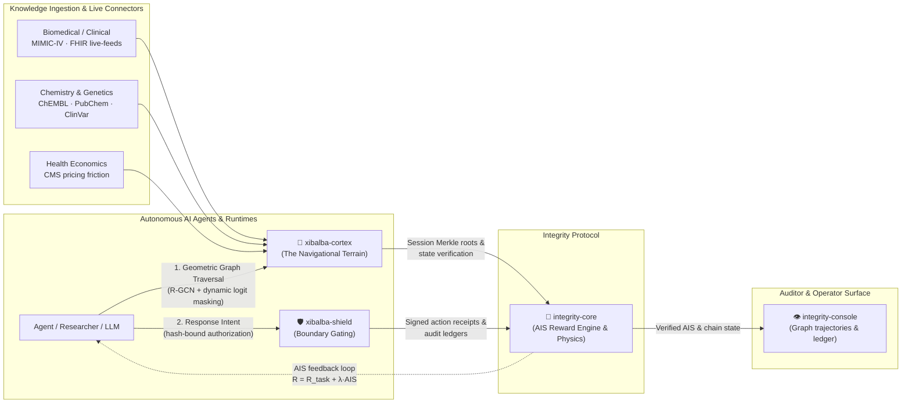

## Table of contents

- [Cortex is a standalone product first](#cortex-is-a-standalone-product-first)
- [Role: 🧠 The Navigational Engine](#role-the-navigational-engine)
- [The Four-Repository Ecosystem Topology](#the-four-repository-ecosystem-topology)
- [Inbound: Geometric Traversal & Multi-Harness Ingestion](#inbound-geometric-traversal--multi-harness-ingestion)
- [Outbound: Session Merkle Anchoring (integrity-core)](#outbound-session-merkle-anchoring-integrity-core)
- [Outbound: Operator Visualization (integrity-console)](#outbound-operator-visualization-integrity-console)
- [Related pages in sibling repos](#related-pages-in-sibling-repos)

## Cortex is a standalone product first

Xibalba Cortex operates as a standalone neuro-symbolic knowledge graph and active inference engine with **any** MCP-speaking agent harness — Claude Code, Codex, Google Antigravity CLI, or cloud-hosted agent fleets via [Generic Ingestion](../concepts/generic-ingestion.md). Store/recall, model-exchange capture, session Merkle-root verification, entity/relation graph traversal, and contradiction/lifecycle management are 91 live MCP tools operating with zero external runtime dependencies (see [MCP Tool Surface](../concepts/mcp-tool-surface.md)).

## Role: 🧠 The Navigational Engine

In the Integrity Ecosystem, Cortex provides the **navigational terrain** for autonomous agents:
- **Discards unconstrained token guessing:** Agents traverse verified topological graph edges ($E(h,r,t) = \|h+r-t\|$) under Relational Graph Convolutional Networks (R-GCN) and dynamic logit masking ($z_{\text{masked}} = z \circ M + (-\infty \times (1 - M))$).
- **Temporal Event Reification:** Reifies time-series clinical and operational events into discrete DAG nodes, evaluated via Temporal Knowledge Graph Embeddings (TTransE).
- **Multi-Domain Grounding:** Integrates live biomedical datasets (MIMIC-IV, FHIR feeds, ChEMBL, PubChem, ClinVar) and health economic cost friction ($\lambda C(e)$ from CMS fee schedules).
- **The path itself is the proof:** If an edge does not exist, the transition cannot be executed—eliminating hallucination at the structural level.

## The Four-Repository Ecosystem Topology

| Repository | Role | Paradigm & Function |
|---|---|---|
| **`xibalba-cortex`** (this repo) | **🧠 The Navigational Engine** | Neuro-symbolic knowledge graph and active inference engine. Replaces probabilistic text generation with geometric graph traversal (R-GCN + TKGE/TransE), dynamic logit masking, temporal event reification, and domain connectors (Biomedical/MIMIC-IV, FHIR live-feeds, ChEMBL, CMS economic cost friction $\lambda C(e)$). |
| **`integrity-core`** | **🦴 The Physics Engine of the Machine Economy** | Implements the Autonomous Integrity Score (AIS) as the deterministic reward function ($R_{\text{total}} = R_{\text{task}} + \lambda \cdot \text{AIS}$). Governs on-chain DIDs, Behavioral Commitment Chains (BCC), Merkle state anchors, cryptographic state verification, and the on-chain execution firewall. |
| **`xibalba-shield`** | **🛡️ Cryptographic Topology & Response Governance** | Enforces topological boundary gating, zero-probability unauthorized state spaces, and vendor-neutral response governance across enterprise EDRs (CrowdStrike, Defender) and AI agents (MCP, SOAR). *"The EDR detects and acts; Shield proves who authorized it."* Produces tamper-evident audit ledgers and HIPAA assurance packets. |
| **`integrity-console`** | **👁️ The Universal Verifiable Operator Window** | Unified presentation and account layer. Visualizes agent graph navigation trajectories, multi-agent DID credentials, AIS score distributions, real-time response approval queues, and cryptographic Merkle verification. |

## Inbound: Geometric Traversal & Multi-Harness Ingestion

Agents query knowledge, compute latent paths, and store turns via MCP. Supported harnesses (`claude`, `agy`, `codex`) use runtime observation hooks; generic harnesses call `memory_ingest_agent_turn` directly. Traversal paths form verifiable cryptographic trajectories.

## Outbound: Session Merkle Anchoring (integrity-core)

Session Merkle roots (see [Hash Chain and Merkle Roots](../concepts/hash-chain-and-merkle-roots.md)) are committed to `integrity-core` via BCC middleware (`XIBALBA_ANCHOR_URL`). Anchoring is triggered manually via `memory_anchor_session_root` or automatically on session close (`XIBALBA_AUTO_ANCHOR_ON_SESSION_END=1`). The resulting on-chain state anchors feed into the oracle's deterministic AIS calculation ($R_{\text{total}} = R_{\text{task}} + \lambda \cdot \text{AIS}$).

## Outbound: Operator Visualization (integrity-console)

The local operator API (:8420) and Vite viewer (:5190) stream navigation graphs, entity subgraphs, and provenance traces to `integrity-console`, allowing operators to inspect agent trajectories and verification states in real time.

## Related pages in sibling repos

- `xibalba-shield` wiki — [Ecosystem Role](https://github.com/XibalbaTechSol/xibalba-shield/wiki/ecosystem-role)
- `integrity-core` canonical authority map: [`integrity-core/docs/ecosystem/ECOSYSTEM.md`](https://github.com/XibalbaTechSol/integrity-core/blob/main/docs/ecosystem/ECOSYSTEM.md)
- `integrity-console` — [Universal Verifiable Operator Window](https://github.com/XibalbaTechSol/integrity-console)
